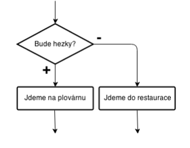
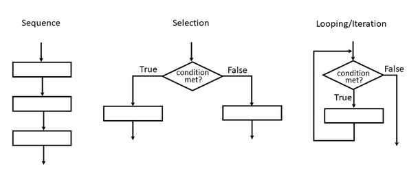

<!-- _class: title -->

# Algoritmizace jednoduše

🧑‍🏫 Autor: Mgr. Vojtěch Bartoš  
Licence: CC BY-NC-SA

---

# 🎯 Cíle lekce

- pochopit, co je algoritmus
- porovnat algoritmy v běžném životě vs. v informatice
- vyzkoušet tvorbu algoritmů na praktických ukázkách

---

# ℹ️ Co je to algoritmus?

- postup **krok za krokem k dosažení cíle**
- musí být jednoznačný a srozumitelný
- výsledkem je řešení problému

---

# ℹ️ Proč bychom měli algoritmům rozumět?

- **algoritmy jsou všude kolem nás**
- recept na vaření, návod na lego, pravidla hry
- cesta do školy
- skládání papírové vlaštovky
- zobrazování obsahu na Instagramu,…

---

<!-- _class: task -->

# 💼 Úkol: Skládání vlaštovky #1

🎯 **Cíl:** vyzkoušet tvorbu i použití algoritmu

📋 **Zadání:**

- rozdělte se do dvojicí
- zadavatel instrukcí určuje pracovní postup složení vlaštovky
- vykonavatel plní instrukce **přesně a doslovně** a vlaštovku skládá

✅ **Výstup:**
- diskuze

---

<!-- _class: task -->

# 💼 Úkol: Skládání vlaštovky #2

🎯 **Cíl:** vyzkoušet tvorbu i použití algoritmu s omezením

📋 **Zadání:**

- rozdělte se do dvojicí
- zadavatel instrukcí určuje pracovní postup složení vlaštovky, ale je **otočen zády k vykonavateli**
- vykonavatel plní instrukce **přesně a doslovně** a vlaštovku skládá

✅ **Výstup:**
- diskuze

---

<!-- _class: task -->

# 💼 Úkol: Skládání vlaštovky #3

🎯 **Cíl:** vyzkoušet tvorbu i použití algoritmu s ještě větším omezením

📋 **Zadání:**

- rozdělte se do dvojicí
- zadavatel instrukcí určuje pracovní postup složení vlaštovky, ale je **otočen zády k vykonavateli**
- vykonavatel plní instrukce **přesně a doslovně** a vlaštovku skládá, **nesmí při tom nic říkat**

✅ **Výstup:**
- diskuze

---

# ℹ️ Jak algoritmus zaznamenat?

- přirozený jazyk (text, recept)
- diagram (blokové schéma)
- pseudokód (jednoduchý zápis podobný kódu)

---

# ℹ️ Základní stavební kameny algoritmu

- sekvence: kroky jdou po sobě
- podmínka (rozhodování): „pokud…, jinak…“
- smyčka (opakování) – krok se opakuje vícekrát

---

<!-- _class: task -->

# 💼 Úkol: Kreslení diagramu #1

🎯 **Cíl:** zaznamenat algoritmus formou diagramu

📋 **Zadání:**

- běžte na [excalidraw.com](https://excalidraw.com)
- nakreslete jednoduché schéma obsahující sekvenci, podmínku a smyčku

✅ **Výstup:**
- diskuze

---

<!-- _class: task -->

# 💼 Úkol: Kreslení diagramu #2

🎯 **Cíl:** zaznamenat vaše ranní stávání formou diagramu

📋 **Zadání:**

- běžte na [excalidraw.com](https://excalidraw.com)
- nakreslete jednoduché schéma obsahující sekvenci, podmínku a smyčku
- diagram musí zaznamenat vaší ranní rutinu před školou

✅ **Výstup:**
- odkaz na diagram nahrajte do Google Classroom

---

<!-- _class: task -->

# 💼 Úkol: Vizuální programování #1

🎯 **Cíl:** vyzkoušet algoritmizaci se smyčkami

📋 **Zadání:**

- běžte na [lightbot.lu](https://lightbot.lu)
- vyzkoušejte si projít co nejvíce úrovní v daném časovém limitu
- začněte od 0. úrovně 

✅ **Výstup:**
- diskuze

---

<!-- _class: task -->

# 💼 Úkol: Vizuální programování #2

🎯 **Cíl:** vyzkoušet různé typy algoritmizace

📋 **Zadání:**

- běžte na [blockly.ganes](https://blockly.games/?lang=cs)
- vyzkoušejte si projít co nejvíce úrovní v daném časovém limitu
- začněte od 0. úrovně 

✅ **Výstup:**
- diskuze

---

# 🧠 Souhrn lekce

- algoritmus = **přesný postup řešení problému**
- může být zapsán různými způsoby (slova, diagram, kód)
- základní struktury: sekvence, podmínky, smyčky

---

<!-- _class: closing -->

# Děkuji za pozornost!

🧑‍🏫 Autor: Mgr. Vojtěch Bartoš  
© Licence: CC BY-NC-SA  
www.otevrenainformatika.cz
