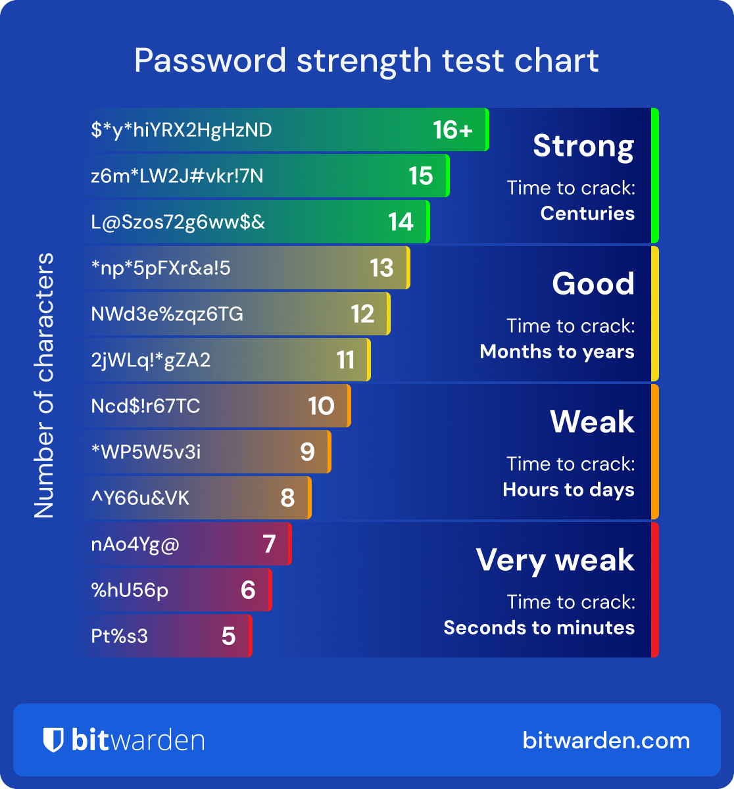
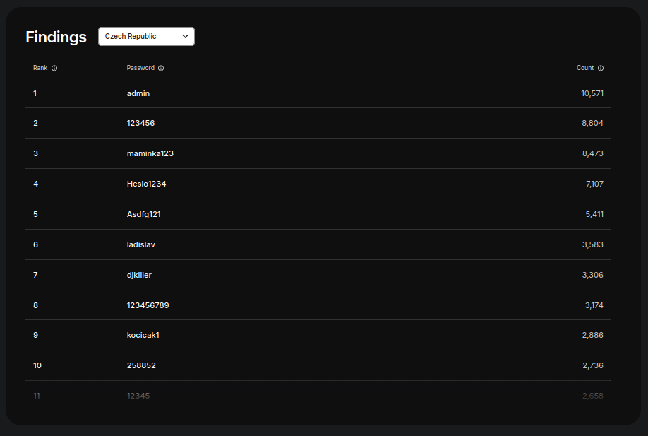
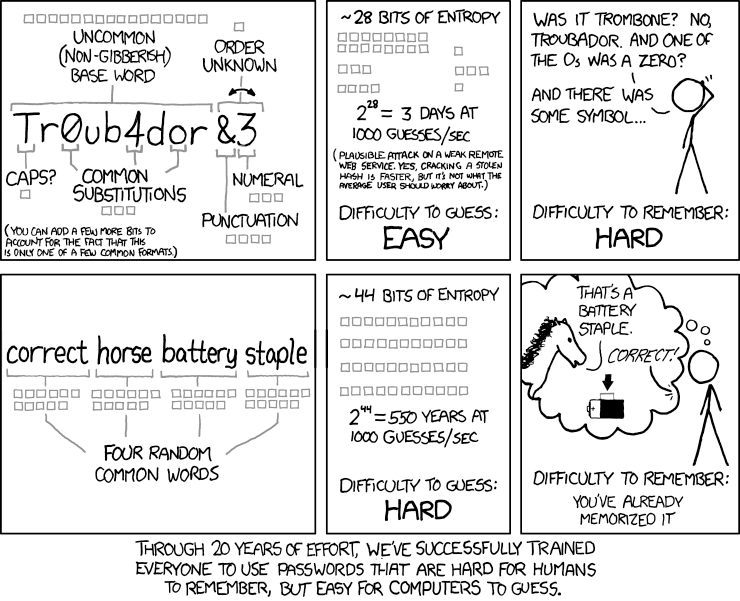

<!-- _class: title -->

# Hesla a zabezpečení účtů
## aneb Asi byste si měli změnit heslo

🧑‍🏫 Autor: Mgr. Vojtěch Bartoš  
Licence: CC BY-NC-SA

<!--
Představte téma lekce pro druhý ročník: bezpečná hesla. Lekce počítá s připojením k internetu a zařízeními pro samostatnou práci.
-->

---

# 🎯 Cíle lekce

- získáte přehled o nástráhách tvorby silného hesla
- navrhnete bezpečná a jedinečná hesla
- vysvětlíte dvoufaktorové ověření

<!--
Seznamte žáky s cíli a upozorněte, že při aktivitách nikdy nebudou zadávat ani sdílet svá skutečná hesla.
-->

---

# ℹ️ Proč řešit hesla?

- účty obsahují zprávy, fotografie nebo přístup k penězům
- cílem útoku může být i herní účet nebo digitální identita
- ukradený účet lze zneužít k podvodům na dalších lidech
- útočníci zkoušejí hesla automatizovaně

> Co by se stalo, kdyby někdo získal přístup k vašemu účtu?

<!--
Ptejte se na možné dopady, například ztrátu dat, vydávání se za majitele účtu nebo oslovení jeho kontaktů. Žáci nemají sdělovat svá hesla ani citlivé údaje.
-->

---

# ℹ️ Myslíte si, že máte bezpečné heslo?

- sílu ovlivňuje délka a především **nepředvídatelnost**
- odhad si můžete vyzkoušet na [Password Meteru](https://passwordmeter.com/) nebo v [Bitwarden Password Strength Testu](https://bitwarden.com/password-strength/)
- zadávejte pouze **vymyšlená hesla**, která nikde nepoužíváte
- výsledek (úroveň neprolomitelnosti) je orientační

<!--
Skutečná hesla nezadávejte do online testů. Porovnejte jen fiktivní příklady a upozorněte, že různé nástroje používají odlišné modely.
-->

---

# ℹ️ Jak dlouho trvá prolomit heslo?

- záleží na způsobu útoku, výpočetní síle i ochraně služby
- krátké a běžné heslo může být uhodnuto velmi rychle
- delší, náhodně vytvořená hesla bývají odolnější
- odhady typu „minuty“ nebo „staletí“ nejsou předpověď

<!--
Příklady - vypište postupně na tabuli a ptejte se studentů na jejich odhad délky prolomení.
Prozkoumejte, co snižuje nebo zvyšuje délku prolomení.
[1234] - 0 sekund
[123456789] - 0 sekund
[J1rk4] - 10 sekund
[v0jt!!k] - 17 minut
[xx!Pepino12!] - 5 měsíců
[5@sa4:\d562122!] - staletí
[Pestuju4Papriky!] - staletí

-->

---

# ℹ️ Síla hesla podle počtu znaků

---

# ℹ️ Někdy ani není hrubá síla potřeba

- útočník může zkusit seznamy **častých a uniklých hesel**
- může využít jméno, zájmy či jiné veřejné údaje
- běžné nahrazování písmen čísly nemusí pomoci
- stejné heslo použité u více služeb usnadní další útok

<!--
Ukažte například [seznam častých hesel](https://nordpass.com/most-common-passwords-list/). Vysvětlete slovníkový útok a zkoušení uniklých kombinací na jiných službách. Konkrétní hesla ze seznamu nepoužívejte.
-->

---

<!-- _class: task -->

# 💼 Úkol: Unikly vaše soukromé údaje?

🎯 **Cíl:** ověřit, zda bylo vaše heslo ukradeno

📋 **Zadání:**

- otevřete [Have I Been Pwned](https://haveibeenpwned.com/)
- ověřte svůj e-mail, nebo použijte příklad

✅ **Výstup:** diskuze

<!--
Připravte pro žáky, kteří nechtějí zadávat vlastní adresu, vhodný příklad. Nevyžadujte sdílení adres ani výsledků a nezadávejte skutečná hesla. Nález neznamená, že je účet právě napaden; nepřítomnost adresy v databázi není důkaz, že k úniku nikdy nedošlo. Při úniku změňte dotčené heslo i všude, kde bylo použito znovu, a zapněte 2FA, pokud je dostupné.
-->

---

# ℹ️ Seznam častých českých hesel

---

# ℹ️ Co dělá heslo silným?

- hackeři dokáží otestovat miliardy kombinací za sekundu a jejich možnosti se neustále zlepšují
- délka hesla - čím více znaků, tím lépe
- sada znaků, kterou používáme - čím více různých znaků, tím lépe;
- entropie = míra nepředvídatelnosti ✖️ zapamatovatelnost
> Které z hesel je bezpečnější?
> [P4!r1pm$65.] ✖️ [KoupilJsemSi2Psy]

<!--
Vysvětlete entropii jako míru nepředvídatelnosti hesla. Složitě vypadající známé vzory mohou být snadno uhádnutelné. Délka sama nezachrání předvídatelnou frázi; porovnávané příklady proto nejsou návodem k použití.
-->

---

# ℹ️ Jaké heslo si tedy nastavit?

- použijte dlouhou **heslovou frázi** z náhodně vybraných slov
- vyhněte se osobním údajům a známým citátům
- pro každý účet vytvořte jiné heslo
- ukázkové fráze z prezentace nikdy nepoužívejte

<!--
Původní prezentace uvádí příklady jako modra-kocka-skace-pres-plot-2026 nebo západ-slunce-zrcadlo-orchidej-avalon. Veřejné příklady jsou již známé, a proto je nelze použít jako skutečné heslo. Náhodně vybraná slova bývají bezpečnější než předvídatelná věta nebo osobní informace.
-->

---

# ℹ️ Jaké heslo si tedy nastavit?

---

# ℹ️ Bezpečnost a zapamatovatelnost

- změť znaků může být obtížná k zapamatování
- fráze z náhodných slov se může pamatovat lépe
- ani dlouhé heslo není bezpečné, pokud je známé nebo použité jinde
- správce hesel pomůže s jedinečnými hesly pro jednotlivé účty

---

# ℹ️ Prolomení hesla nemusí znamenat konec

- **dvoufaktorové ověření (2FA)** přidává další vrstvu ochrany
- něco, co **vím**: heslo nebo PIN
- něco, co **mám**: telefon nebo bezpečnostní klíč
- něco, co **jsem**: například otisk prstu

<!--
Dva faktory pocházejí z různých kategorií. Ověření aplikací nebo bezpečnostním klíčem zpravidla poskytuje lepší ochranu než SMS; dostupné možnosti se liší podle služby. Ani 2FA není neprůstřelné: útočník může vylákat kód nebo schválení přihlášení. Diskutujte, kde mají žáci 2FA zapnuté, bez sdílení údajů.
-->

---

# ℹ️ Co dělat, když mám více účtů?

- opakované heslo ohrožuje při úniku více účtů
- **správce hesel** ukládá a generuje jedinečná hesla
- chraňte jej silným hlavním heslem a pokud možno 2FA

<!--
Příklady správců: Bitwarden, Apple Passwords a Google Password Manager.
-->

---

<!-- _class: task -->

# 💼 Úkol: Na den kyberbezpečnostním expertem (1/2)

🎯 **Cíl:** analyzujte sílu poskytnutých hesel

📋 **Zadání:** jste auditoři firmy Děravý & Syn

- zkopírujte tabulku ze zadání v Google Classroom
- ohodnoťte každé heslo na škále **1–10**
- stručně vysvětlete, proč je slabé nebo silné

✅ **Výstup:** vyplněný první list tabulky

<!--
Použijte pouze fiktivní hesla z připravené tabulky, nikoli skutečná hesla žáků. Škála je orientační; sledujte délku, předvídatelnost, známé vzory a možnou souvislost s osobními údaji.
-->

---

<!-- _class: task -->

# 💼 Úkol: Na den kyberbezpečnostním expertem (2/2)

🎯 **Cíl:** navrhněte pravidla pro tvorbu hesel

📋 **Zadání:** ředitel firmy chce bezpečná a použitelná pravidla

- přejděte na druhý list tabulky
- navrhněte pravidla pro hesla zaměstnanců
- myslete na jedinečnost, délku i správce hesel

✅ **Výstup:** tabulku Google Sheets odevzdejte do Google Classroom

<!--
Diskutujte rovnováhu mezi bezpečností a použitelností. Pravidla mohou zahrnovat ověřování uniklých hesel, 2FA a bezpečnou obnovu přístupu. Ukažte, kam hotovou tabulku odevzdat.
-->

---

# 🧠 Souhrn lekce

- kvalitní heslo je dlouhé, nepředvídatelné, ale zapamatovatelné
- každý účet by měl mít svoje vlastní, jedinečné heslo
- správci hesel a 2FA přidávají další vrstvy ochrany

<!--
Požádejte žáky, aby uvedli, proč není vhodné opakovat hesla.
-->

---

<!-- _class: closing -->

# Děkuji za pozornost!

🧑‍🏫 Autor: Mgr. Vojtěch Bartoš  
© Licence: CC BY-NC-SA  
www.otevrenainformatika.cz

<!--
Uzavřete lekci a připomeňte odevzdání tabulky s auditem hesel a navrženými pravidly do Google Classroom.
-->
