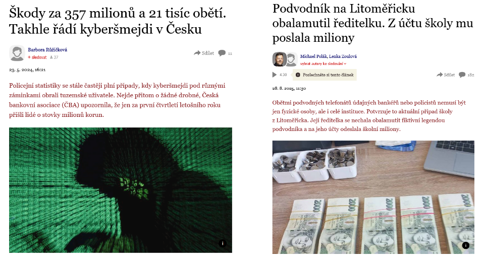
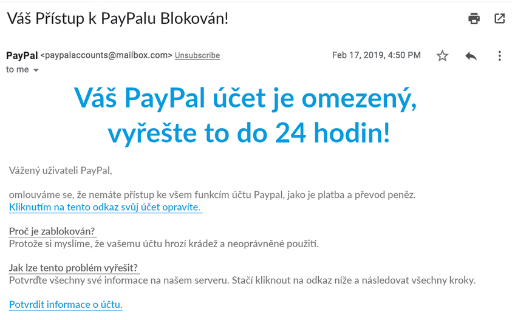

<!-- _class: title -->

# Sociální inženýrství a phishing
## Kyberbezpečnost

🧑‍🏫 Autor: Mgr. Vojtěch Bartoš  
Licence: CC BY-NC-SA

---

# 🎯 Cíle lekce

- rozpoznáte znaky phishingu a jiných typů sociálního inženýrství

---

# ℹ️ Sociální inženýrství = hackování lidí

- útočník využívá důvěru a emoce, například strach nebo zvědavost
- **phishing**: původce mailu se tváří jako autorita (např. Google)
- **vishing**: falešný bankéř volá kvůli „napadenému účtu“
- **smishing**: SMS žádá doplatek za údajný balíček
- **baiting**: nastražení infikované flešky na parkovišti firmy

<!--
Vysvětlete, že i dobře zabezpečený systém může být obejit manipulací uživatele. U nalezených médií doporučte nepřipojovat je k zařízení a předat je odpovědné osobě.
-->

---

# ℹ️ Sociální inženýrství je na vzestupu

---

# ℹ️ Podvody mají skutečné následky

- oběťmi mohou být jednotlivci i celé instituce
- podvodníci se mohou vydávat za banku nebo policii
- pod tlakem lze přijít o peníze i přístup k účtům

> Proč může podvod přesvědčit i zkušeného člověka?

<!--
Původní snímek odkazuje na dvě zprávy: [škody a oběti kyberpodvodů](https://www.novinky.cz/clanek/internet-a-pc-bezpecnost-skody-za-357-milionu-a-21-tisic-obeti-takhle-radi-kybersmejdi-v-cesku-40473174) a [podvod zaměřený na školu](https://www.novinky.cz/clanek/internet-a-pc-bezpecnost-podvodnik-na-litomericku-obalamutil-reditelku-z-uctu-skoly-mu-poslala-miliony-40536093). Veďte diskusi bez obviňování obětí.
-->

---

# ℹ️ Podvody kombinují různé způsoby

- zpráva může vyvolat obavy a přimět oběť otevřít odkaz
- podvodný web může následně požádat o přihlašovací údaje
- telefonát může podvod doplnit a zvýšit tlak na oběť

🎬 [Video: ukázka kombinovaného podvodu](https://www.youtube.com/watch?v=auGnJQY7J-U)

<!--
Pusťte video a proberte jednotlivé kroky útoku. Připomeňte, že údaje ani kódy nesdělujeme volajícímu jen proto, že působí důvěryhodně.
-->

---

# ℹ️ Rybaření v kyberprostoru: phishing

- **phishing** se snaží vylákat citlivé údaje nebo přístup k účtu
- útočník se vydává za instituci, banku nebo známého člověka
- podvod může přijít e-mailem, SMS nebo telefonicky
- zpráva často vede na falešný web nebo nutí k jiné akci

> Setkali jste se s podobnou zprávou?

<!--
Phishing je forma sociálního inženýrství. SMS varianta se nazývá smishing, telefonická vishing. Zkušenosti sdílejte bez zveřejňování osobních údajů, zpráv s aktivními odkazy nebo přihlašovacích údajů.
-->

---

# ℹ️ Ukázka podvodného e-mailu

---

# ℹ️ Jak poznat podvodný e-mail?

- **urgence**: „Máte 24 hodin!“ nebo „Jednejte ihned!“
- podezřelá adresa odesílatele či cílového webu
- obecný pozdrav nebo nečekaná výzva k akci
- žádost o heslo, kód, platbu či otevření přílohy

<!--
Žádný jednotlivý znak není spolehlivý důkaz: podvodná zpráva může být napsána bez chyb a znát vaše jméno. Adresa odesílatele může být podvržena. Podezření ověřujte nezávislým kontaktem, nikoli odpovědí na zprávu.
-->

---

# ℹ️ Typosquatting: pozorně čtěte adresy

- text odkazu může ukazovat jinam, než tvrdí
- před kliknutím zkontrolujte skutečný cíl odkazu
- **typosquatting** využívá podobné nebo chybně napsané domény
> `facebook.com` a `faceboook.com` nejsou totéž
> `rnicrosoft.com` (r + n vypadá jako m)

<!--
Na počítači ukažte náhled cíle po najetí myší; na mobilu může pomoci podržení odkazu, ale postup záleží na zařízení. Překlep není jediná možnost: rn může připomínat m. Ani správně vypadající odkaz nebo HTTPS samy o sobě nezaručují bezpečnost.
-->

---

<!-- _class: task -->

# 💼 Úkol: Phishingový simulátor

🎯 **Cíl:** procvičte rozpoznávání podvodných e-mailů

📋 **Zadání:** samostatná práce

- otevřete [Phishing Quiz od Googlu](https://phishingquiz.withgoogle.com/)
- projděte všechny příklady až do konce
- u každé zprávy hledejte podezřelé znaky

✅ **Výstup:** společná diskuse nad výsledky

<!--
Diskutujte, proč se některé příklady poznávají obtížně.
-->

---

# ℹ️ Jak se nenechat ulovit?

1. **zpomalte** a nenechte se tlačit k okamžité reakci
2. ověřte zprávu známým kontaktem nebo ve vlastní aplikaci
3. zkontrolujte cílovou adresu, nikoli jen text odkazu
4. neotvírejte podezřelé přílohy ani nesdělujte kódy

<!--
Banku kontaktujte číslem z oficiálního webu, aplikace nebo platební karty, ne číslem z podezřelé zprávy. Nečekaná příloha včetně ZIP či EXE je riziková; škodlivé mohou být i jiné formáty.
-->

---

# 🧠 Souhrn lekce

- sociální inženýrství manipuluje důvěrou a emocemi
- útočníci mohou kombinovat zprávy, weby i telefonáty
- urgence, podezřelá adresa, nečekaná výzva nebo žádost o heslo či kód mohou značit podvod
- zpomalíme, neotevíráme podezřelé přílohy a nesdělujeme hesla ani ověřovací kódy

<!--
Požádejte žáky, aby vysvětlili phishing a popsali postup při podezřelé zprávě.
-->

---

<!-- _class: closing -->

# Děkuji za pozornost!

🧑‍🏫 Autor: Mgr. Vojtěch Bartoš  
© Licence: CC BY-NC-SA  
www.otevrenainformatika.cz
